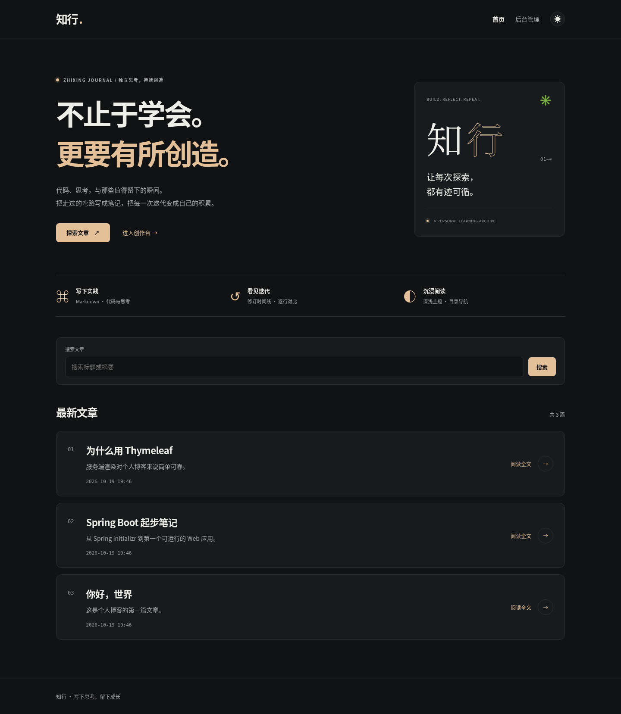

# 知行 · 学习成长博客

用文字整理思考，用代码验证想法。基于 Spring Boot 的个人技术博客，支持从草稿写作到发布、修订与恢复的完整流程。



## 功能与特色

- **Markdown 写作**：服务端预览、标题目录、代码高亮与复制、阅读时长估算。所有静态资源本地提供，不依赖运行时 CDN。
- **文章成长记录**：每次保存保留内容快照与修改说明；历史分页、查看、恢复。恢复生成新版本并转为草稿，原有历史不丢失。
- **并发保护**：旧编辑页不能覆盖新内容，冲突时保留输入。文章与历史在同一事务内保存。
- **完整基础流程**：文章创建、编辑、发布、撤回、删除确认；公开和后台分页、标题/摘要搜索、表单校验。
- **持久化**：默认 H2 文件库，重启保留数据；Flyway 管理建表，Hibernate 校验结构。空库仅初始化 3 篇示例文章。
- **阅读体验**：统一视觉、响应式布局、键盘导航、空状态和友好错误页。
- **安全边界**：公开查询隔离草稿；正文统一清洗；CSRF、CSP 和安全响应头；后台不要求登录，默认仅监听本机。

## 技术栈

Java 21 **JDK** · Spring Boot 4.1.1 · Spring MVC · Thymeleaf · JPA/Hibernate · H2 · Flyway · Spring Security · CommonMark · jsoup。
测试使用 JUnit、MockMvc、Mockito 和 Playwright/Chromium。依赖版本见 `pom.xml` 与浏览器测试锁文件。

## 本地启动

先确认 `java -version` 和 `javac -version` 都为 21。仅有 Java 运行时无法编译。首次构建需要访问 Maven Central。

### 一键检查并启动

Windows 双击仓库根目录的 `start.cmd`；Linux / macOS 运行 `bash start.sh`。
脚本会先运行测试并重新构建，再启动当前代码，避免误用旧 JAR。
首次运行需要联网下载依赖。启动后保持终端窗口打开，在浏览器打开 `http://localhost:8080`。

也可以按下面步骤分别构建和启动。

Linux / macOS：

```bash
bash mvnw -B -ntp verify
bash scripts/run-dev.sh
```

Windows PowerShell：

```powershell
.\mvnw.cmd -B -ntp verify
java -Djava.net.preferIPv4Stack=true -jar target/blog-0.0.1-SNAPSHOT.jar
```

在浏览器打开 `http://localhost:8080`。后台路径 `/admin/posts`，新建文章 `/admin/posts/new`。使用 `Ctrl+C` 停止应用。

始终从仓库根目录启动。默认数据存于 `data/blog.mv.db`，不会提交到 Git。可通过 `BLOG_DATA_DIR` 指定其他数据目录，通过启动参数 `--server.port=8081` 改端口。H2 Console 默认关闭。

**备份**：先停止应用，再复制整个 `data/` 目录；恢复时也先停止应用，再放回同一数据目录。不要把 `data/` 作为清理缓存删除。

**运行范围**：这是本地开发与面试演示版本，后台无认证，请保持默认本机监听。`prod` 是未验证的 MySQL 配置骨架，需要 `DB_URL`、`DB_USERNAME`、`DB_PASSWORD`、独立建表迁移和访问控制；本项目的 Flyway SQL 面向 H2，不直接适用于 MySQL。

## 测试与验收

```bash
bash mvnw -B -ntp verify
```

当前 JVM 基线：**84 项，0 失败、0 错误、0 跳过**。覆盖原有 CRUD/搜索分页、草稿隔离，以及 Markdown 安全、修订恢复、事务回滚、真实并发、CSRF 和迁移一致性。

可选浏览器验收，需要 Node.js 22+：

```bash
cd tests/browser
npm ci
npx playwright install chromium
npm test
```

Linux 若提示缺少系统库，按 Playwright 官方方式运行 `npx playwright install --with-deps chromium`。
已有系统 Chromium 时，可设置 `CHROMIUM_PATH` 为其可执行文件，省去浏览器下载。
浏览器测试会启动自己的 JVM 和临时 H2 文件库，验证预览、发布、恢复、并发编辑、删除、320/390/768/1440px 布局以及真实进程重启；不会操作开发数据库。
默认使用测试端口 18080，可通过 `BLOG_TEST_PORT` 修改。截图和日志路径在测试输出中显示。

[CI 配置](.github/workflows/verify.yml) 会在 push / PR 后执行 JVM 和浏览器验收。配置已提供，远程运行结果以 GitHub Actions 实际记录为准。

## 目录与设计

```text
src/main/java/com/example/blog/
  config/       开发数据与请求防护
  domain/       Post、PostStatus、PostRevision
  repository/   文章查询与历史存取
  service/      事务化写入、安全 Markdown 渲染
  web/          页面、预览、表单和冲突处理
src/main/resources/
  db/migration/ H2 版本化建表 SQL
  templates/    Thymeleaf 页面
  static/       自有 CSS/JS 与本地代码高亮资源
src/test/       JVM 测试及独立测试配置
tests/browser/ 真实浏览器与重启验收
```

- [关键设计与取舍](docs/ARCHITECTURE.md)：事务、快照、乐观锁、渲染边界。
- [面试演示与理解检查](docs/DEMO.md)：6–8 分钟演示路线及需要解释的问题。
- [验证记录与 AI 协作](docs/VALIDATION.md)：验证方式、实际困难、限制。
- [升级计划](docs/UPGRADE.md) · [第三方资源与许可](docs/THIRD_PARTY.md) · [手机实机截图](docs/screenshots/home-mobile.png)。

## 实际遇到的问题

1. **能运行 Java 却不能编译**：机器只有 JRE；补齐 Java 21 JDK，并确保 Maven 使用正确的 `JAVA_HOME`。
2. **云端 Maven 无法解析仓库**：Maven 不自动使用 HTTPS_PROXY；在仓库外配置代理与可写缓存，保留 TLS 和依赖校验。
3. **多窗口覆盖与历史一致性**：增加版本凭据、JPA 乐观锁、事务和数据库唯一约束；以并发测试和两标签页验收验证。
4. **恢复可能公开旧草稿**：规定恢复一律转为草稿，保留全部历史，并测试公开地址重新返回 404。
5. **数据重启丢失**：改为文件库、Flyway 迁移与实体校验，用真实 JVM 重启验证，测试库保持隔离。

Git 保留原有初始化、CRUD、草稿、分页和搜索等阶段提交；升级按计划、Markdown、修订、持久化与界面、验收交付分阶段提交，没有改写原历史。
