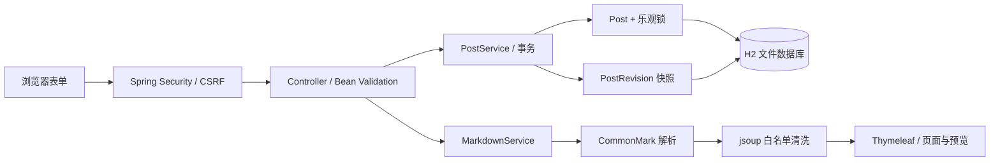

# 关键设计与取舍

## 请求如何流转

- **Controller** 处理 HTTP 参数、分页、表单错误和跳转。公开列表和详情只查询 `PUBLISHED`。
- **PostService** 在同一事务中协调文章与修订记录。`flush()` 在写快照前检查并发更新并取得新版本号；后续出错时整个事务回滚。
- **PostRevision** 是只追加的内容快照，没有更新接口。删除文章时同步删除历史。历史列表每页 10 条，并按版本号倒序。
- **MarkdownService** 是正文进入 HTML 的唯一信任边界。普通标题、摘要和修改说明始终由 Thymeleaf 转义。

## 两个核心实体

| 数据 | 主要字段 | 约束 |
| --- | --- | --- |
| Post | 标题、摘要、Markdown、状态、创建/修改时间、version | `@Version` 防止并发覆盖 |
| PostRevision | 所属文章、版本号、完整内容、当时状态、修改说明、保存时间 | `(post_id, revision_number)` 唯一，外键约束 |

### 为什么选完整快照

个人博客修改频率低，完整快照让恢复逻辑清晰，不需要串联差异补丁。代价是占用更多存储；目前单篇正文限制 100000 字符，历史分页查询，但没有历史压缩和清理策略。内容量大时再引入保留策略。

### 保存和恢复的规则

- 新建文章生成版本 1，每次保存生成新版本，即使只是状态变化或重复保存。
- 旧文章和示例文章在首次编辑时同时保留原始内容，不伪造过去的修订时间。
- 首次编辑先在内存构造基线快照，乐观更新成功后才插入，避免两个窗口竞争创建相同基线。
- 恢复读取“版本 ID + 所属文章 ID”，拒绝跨文章操作。
- 恢复是一次新的修改，保留原有全部历史，且**一律恢复为草稿**。原本公开的文章也会撤回，页面操作前有明确提示。
- 编辑、恢复和删除都携带页面读取时的版本号。旧表单不能覆盖新内容；数据库的 `@Version` 同时防住检查与保存之间的竞争。
- 编辑冲突在原表单显示提示，保留提交内容；删除/恢复冲突返回 409。数据库并发冲突也映射为 409 或可恢复的表单错误。

## 安全与本地边界

- 后台不要求登录，符合题目；默认监听 `127.0.0.1`。CSRF **不等于认证**，不适合直接公开部署。
- Spring Security 为所有修改请求提供 session CSRF 校验，Thymeleaf 自动给 POST 表单加入隐藏字段；预览使用请求头传 token。
- 原始 HTML 转义、危险 URL 清洗、图片排除，CSP 禁止内联脚本、外部脚本、iframe 和插件内容；预览与正文规则完全相同。
- 所有 JS、CSS 和代码高亮随项目提供。离页提醒不将未发布内容复制到 localStorage。
- H2 Console 默认关闭，不暴露数据库操作页面。错误页不输出异常堆栈和数据库细节。

## 数据与环境

默认 `dev` 使用 `data/blog.mv.db`。Flyway 维护 H2 的版本化 SQL，Hibernate 只 `validate`，不会在停止时删除表。
测试使用独立内存库，不连接开发文件库；迁移测试单独验证 SQL 与实体一致。
浏览器测试使用临时文件库，真正停止并重新启动 JVM，以验证文章和历史都持久化。

当前 SQL 面向 H2，MySQL `prod` 仍是未验收的旧配置骨架，不属于默认交付。没有自动数据库备份、登录认证或公网生产部署方案。

## 为什么不拆前后端

题目的重点是走通开发、Git 和本地部署。Thymeleaf 表单足够完成此工作流，并能通过 MockMvc 检查真实模板。
JavaScript 只增强预览、复制和离页提醒；核心的发布、编辑、恢复和删除仍使用普通表单。
