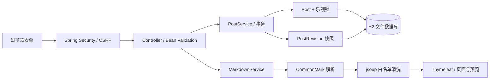

# 关键设计与取舍

## 请求如何流转

- **Controller** 处理 HTTP 参数、分页、表单错误和跳转。公开列表和详情只查询 `PUBLISHED`。
- **PostService** 在同一事务中协调文章与修订记录。`flush()` 在写快照前检查并发更新并取得新版本号；后续出错时整个事务回滚。
- **PostRevision** 是只追加的内容快照，没有更新接口。删除文章时同步删除历史。历史列表每页 10 条，并按版本号倒序。
- **MarkdownService** 是正文进入 HTML 的唯一信任边界。普通标题、摘要和修改说明始终由 Thymeleaf 转义。

## 两个核心实体

| 数据 | 主要字段 | 约束 |
| --- | --- | --- |
| Post | 标题、摘要、Markdown、状态、创建/修改时间、version | `@Version` 防止并发覆盖 |
| PostRevision | 所属文章、版本号、完整内容、当时状态、修改说明、保存时间 | `(post_id, revision_number)` 唯一，外键约束 |

### 为什么选完整快照

个人博客修改频率低，完整快照让恢复逻辑清晰，不需要串联差异补丁。代价是占用更多存储；目前单篇正文限制 100000 字符，历史分页查询，但没有历史压缩和清理策略。内容量大时再引入保留策略。

### 保存和恢复的规则

- 新建文章生成版本 1，每次保存生成新版本，即使只是状态变化或重复保存。
- 旧文章和示例文章在首次编辑时同时保留原始内容，不伪造过去的修订时间。
- 首次编辑先在内存构造基线快照，乐观更新成功后才插入，避免两个窗口竞争创建相同基线。
- 恢复读取“版本 ID + 所属文章 ID”，拒绝跨文章操作。
- 恢复是一次新的修改，保留原有全部历史，且**一律恢复为草稿**。原本公开的文章也会撤回，页面操作前有明确提示。
- 编辑、恢复和删除都携带页面读取时的版本号。旧表单不能覆盖新内容；数据库的 `@Version` 同时防住检查与保存之间的竞争。
- 编辑冲突在原表单显示提示，保留提交内容；删除/恢复冲突返回 409。数据库并发冲突也映射为 409 或可恢复的表单错误。

## 安全与本地边界

- 默认 dev 在 `127.0.0.1` 上保留题目所需的免登录体验。shared/public 或非本机监听强制管理员认证，不能通过布尔开关关闭。公网 public 需可信 HTTPS 代理，8080 不直接发布。
- Spring Security 为所有修改请求提供 session CSRF 校验，Thymeleaf 自动给 POST 表单加入隐藏字段；预览使用请求头传 token。
- 原始 HTML 转义、危险 URL 清洗、图片排除，CSP 禁止内联脚本、外部脚本、iframe 和插件内容；预览与正文规则完全相同。
- 所有 JS、CSS 和代码高亮随项目提供。离页提醒不将未发布内容复制到 localStorage。
- H2 Console 默认关闭；错误页不输出异常堆栈和数据库细节。管理员密码在启动时读取、以 BCrypt 编码，缺失时对外模式拒绝启动。登录每 IP 每分钟限 10 次，最多保存 5000 个限流窗口，不记录账号或密码。

## 数据与环境

默认 `dev` 使用 `data/blog.mv.db`。Flyway 维护 H2 的版本化 SQL，Hibernate 只 `validate`，不会在停止时删除表。
测试使用独立内存库，不连接开发文件库；迁移测试单独验证 SQL 与实体一致。
浏览器测试使用临时文件库，真正停止并重新启动 JVM，以验证文章和历史都持久化。

当前 SQL 面向 H2，MySQL `prod` 仍是未验收的旧配置骨架，不属于默认交付。没有自动数据库备份。已提供单实例 Docker + Caddy HTTPS 部署方案，实际域名与主机仍需部署者准备。

## 为什么不拆前后端

题目的重点是走通开发、Git 和本地部署。Thymeleaf 表单足够完成此工作流，并能通过 MockMvc 检查真实模板。
JavaScript 只增强预览、复制和离页提醒；核心的发布、编辑、恢复和删除仍使用普通表单。

## 版本对比与阅读交互

`RevisionDiffService` 使用有限规模 LCS 比较历史正文和当前正文，提供增删行、双行号和统计。
单侧上限 600 行，时间和空间复杂度 O(m×n)。超过上限返回明确提示，不截断原文、不执行无界计算。
对比输出为普通文本，模板 `th:text` 转义；历史所属文章仍以双 ID 校验。标题、摘要、状态另行对照。

`theme.js` 只在 localStorage 保存主题偏好，不保存密码、草稿或文章正文。
`reading.js` 使用被动滚动监听与 requestAnimationFrame 更新进度，给当前目录添加 aria-current。
关闭 JavaScript 时核心表单与文章阅读仍可用，默认采用 CSS 深色主题。

## 对外认证与部署

`SecurityConfig` 根据 profile 和监听地址决定是否启用认证。公开读取不要求账号；全部 /admin/** 需要认证。
默认用户只有部署者设置的一名管理员；退出注销 session。公网 profile 为 Cookie 设置 Secure，CSRF 一直保留。
转发头只在 public 模式中处理，必须依赖 Compose 的私有应用端口和可信 Caddy 代理界定信任边界。

`/healthz` 实际查询数据库，提供最小 readiness 信号。容器测试覆盖拒绝空凭据、受验证 HTTPS、Secure Cookie、命名卷与重启。
部署和备份细节见 `DEPLOYMENT.md`。

## 读者互动

`ReaderComment` 保存昵称、纯文本、审核状态、创建时间和乐观版本；`ReaderRating` 保存匿名浏览器标识和 1～5 星。两者均通过外键关联文章，删除文章时由数据库级联删除，撤回文章时保留数据但公开入口返回 404。新增 Flyway V2，不改写历史 V1。

`ReaderFeedbackService` 只允许对已发布文章写入，写入时锁定文章行；同文章评分短事务串行处理，结合 `(post_id, reader_id)` 唯一约束，避免首次并发打星重复计票。均分与总数直接从评分行聚合，不维护容易失配的累加字段。互动不修改文章版本或内容快照。

评论默认 PENDING，仅 APPROVED 可公开；HIDDEN 可重新通过。管理员操作携带版本号，旧窗口不能覆盖新审核状态。公开列表和审核列表均分页，索引覆盖文章/状态/时间与审核队列。文本始终 `th:text` 转义，不走 Markdown HTML 渲染。

所有修改仍使用普通 POST + CSRF。匿名标识是随机 UUID Cookie（HttpOnly / SameSite=Lax，HTTPS 下 Secure），并非账户或身份认证。服务只在有界内存中短期保留限流用 IP，不将 IP 写入评论或评分数据库。Cookie 可以清除，攻击者也能模拟多个浏览器，因此仍需人工审核，评分不具备严格防刷保证。
