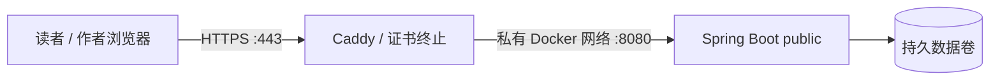

# 公网部署与运维

本文对应 Docker Compose + Caddy、单实例 H2 文件库部署。没有服务器或托管平台账号时，可以先完成本机验证，但不能凭 GitHub 仓库生成一个永久公网地址。

## 1. 准备部署目标

- 一台支持 Docker 的 Linux 主机，建议至少 2 GB 内存；构建时也需要 Java 21 JDK。
- 推荐使用你控制的域名，例如 `blog.your-domain.com`，A 记录指向主机公网 IP；没有域名可按第 9 节配置 IP 证书。
- 入站开放 TCP 80/443；SSH 只向你需要的来源开放。不要向公网开放应用的 8080 或数据库文件。
- 主机能访问镜像仓库、Maven Central 和 Caddy 的证书签发服务。
- 首次上线建议先使用直接 DNS 解析，确认 HTTPS 正常，再配置其他 CDN。

托管平台也可以运行本镜像，但必须提供**持久化磁盘、HTTPS 入口、秘密变量**。只提供临时文件系统的免费实例会在重建后丢失文件数据库，不能直接当作持久化部署。

## 2. 构建与配置

```bash
git clone https://github.com/rswdgvjii4609876-afk/blog.git
cd blog
java -version
javac -version
bash mvnw -B -ntp verify
cp .env.example .env
chmod 600 .env
```

编辑 `.env`，填写：

| 变量 | 说明 |
| --- | --- |
| BLOG_DOMAIN | 真实域名，不带 `https://` 或路径 |
| BLOG_ADMIN_USERNAME | 默认 admin；3–64 位英文字母、数字、点、横线、下划线 |
| BLOG_ADMIN_PASSWORD | 自己生成的随机密码；16–64 字符，最多 72 个 UTF-8 字节 |

密码仅保存在你管理的服务器秘密配置中，不放进 Dockerfile、Git、README 或聊天。
使用特殊字符时遵循 Docker Compose `.env` 的引号规则；随机十六进制密码可避免插值歧义。

```bash
docker compose config --quiet
docker compose up -d --build
docker compose ps
docker compose logs --tail=80 app
docker compose logs --tail=80 caddy
```

`config --quiet` 验证配置但不输出展开后的密码。
Caddy 在应用健康后启动，自动申请证书并将 HTTP 跳转到 HTTPS。首次签发需要域名解析正确。

## 3. 上线验收

用你真实配置的 HTTPS 域名检查：

1. 首页可访问，新库没有示例文章是正常现象。
2. `/healthz` 返回 `{"status":"UP"}`，不返回数据库连接参数或异常堆栈。
3. 未登录打开 `/admin/posts` 跳转 `/login`，历史、对比、预览与写入接口也受保护。
4. 以管理员账号登录，创建草稿；访客仍不能公开查看草稿。
5. 发布后可公开阅读，修改后可查看修订与逐行差异。
6. 退出后不能再进入后台；登录 Cookie 应有 Secure、HttpOnly、SameSite 属性。
7. `docker compose restart app` 后文章与历史仍在。

公开文章与后台管理是不同权限。CSRF 防护不能代替登录；公网模式不能退回本机免登录模式。

## 4. 网络与 HTTPS 的信任边界



- `public` 必须位于可信 TLS 代理后，Cookie 强制 Secure。
- 只有 public 模式处理转发头。应用端口不得绕过代理对外暴露，否则攻击者可以伪造转发信息。
- 提供的 Compose 没有发布应用端口，只发布 Caddy 的 80/443。
- Caddy 的内部上游配置为 `app:8080`，NO_PROXY 排除该内部地址；应用健康检查显式不走外网代理。
- 无密码、过短密码、超出 BCrypt 字节上限等配置会阻止对外模式启动。
- 即使使用 dev，只要改为非本机监听，也会强制认证，防止误把免登录后台暴露出去。
- 登录入口每 IP 每分钟最多 10 次请求。该限流为有界、单实例内存实现，不能替代平台级 DDoS 防护。

## 5. 数据、备份与恢复

Compose 项目名固定为 `zhixing`。应用卷通常为 `zhixing_blog-data`，证书保存在独立 Caddy 卷。
不要使用 `docker compose down -v`，除非你明确要删除所有文章、历史和证书。

### 停机备份

从项目目录执行：

```bash
mkdir -p backups
docker compose stop app
docker cp "$(docker compose ps -a -q app)":/app/data "backups/data-$(date +%Y%m%d-%H%M%S)"
docker compose start app
```

先停应用再复制文件，避免备份到不一致的数据库。请把备份另外存到安全位置；不要上传到公开仓库。
本项目不包含自动备份服务，需要你在主机或平台安排周期任务。

### 恢复与迁移已有本地数据

恢复前先额外备份当前线上数据，确认备份目录确实包含 `blog.mv.db`。
先停止本地/服务器应用，把选定备份内容复制到线上容器的 `/app/data`，再修正权限：

```bash
docker compose stop app
# 将下面路径替换为自己确认过的备份目录；不要原样运行占位路径。
docker cp backups/selected-data/. "$(docker compose ps -a -q app)":/app/data/
docker compose run --rm --no-deps --user 0 --cap-add CHOWN --entrypoint sh app -c 'chown -R 10001:10001 /app/data'
docker compose start app
```

迁移 Windows 上已有的文章时：先关闭本地 Java，备份项目 `data/`，安全上传到服务器，按同一流程恢复。
不要同时让两个应用进程访问同一份 H2 文件。
备份复制和命名卷重启已纳入容器测试；真实用户数据的恢复应先在独立环境演练。

## 6. 更新与回滚

更新前备份数据，且先确认工作区没有未提交的自定义改动：

```bash
git status --short
git pull --ff-only
bash mvnw -B -ntp verify
docker compose up -d --build
docker compose ps
```

更新后重新检查 `/healthz`、登录和一篇文章。不要为了更新删除数据卷。
本轮没有修改数据库 V1。以后如果引入新迁移，旧代码未必支持新结构，不能只退回旧镜像就认为完成回滚；需要配套兼容策略或经过演练的数据恢复。

忘记管理员密码时，在服务器仓库根目录运行：

```bash
python3 scripts/reset-admin-password.py
```

按隐藏提示输入两次新密码，不需要旧密码。脚本仅原子更新 .env 中的密码字段，权限保持 600，
保留账号、IP、数据和证书配置，并重新创建应用、等待健康检查。旧登录会话失效。
不要将新密码放进命令参数或聊天。没有在线注册和找回密码接口。

## 7. 独立部署验证

```bash
bash mvnw -B -ntp verify
docker build -t zhixing-blog:local .
python3 tests/deploy/verify.py
```

测试会创建自己命名的网络、容器和数据卷，自动生成临时测试密码，使用 Caddy 内部 CA 验证 HTTPS。
客户端显式信任该 CA，证书和域名校验保持开启，不使用 `-k` 或忽略证书错误。
测试结束会移除自己的资源，不操作 Compose 正在使用的数据卷。
可通过 BLOG_TEST_IMAGE / BLOG_TLS_TEST_PORT 调整测试镜像和端口。

测试证书只用于隔离验收，不替代你真实域名的受信任公网证书。

## 8. 容量与边界

- 当前是单作者、单实例文件数据库方案，适合小型博客；不支持多个应用副本共同写入同一 H2 卷。
- 容器使用 10001:10001 用户、只读根文件系统和独立可写数据卷，临时文件写入 /tmp。
- Compose 为应用配置 768 MB 内存上限，JVM 根据容器内存控制堆；实际容量仍需按文章规模与并发监测。
- MySQL `prod` 是旧的未验收骨架，不是本文的公网 profile。
- 没有评论、访客注册、分布式会话、多因素认证或自动备份。


## 9. 没有域名：使用公网 IP 的受信任 HTTPS

Let’s Encrypt 已开放 IP 地址证书，要求 `shortlived` ACME profile，有效期约 160 小时。
可用 HTTP-01 / TLS-ALPN-01 验证 IP 控制权，不能用 DNS-01。Caddy 2.11.7 已确认支持所需 profile 语法。

首次部署可在服务器执行 `python3 scripts/setup-ip.py 你的公网IPv4`，按隐藏提示输入两次自己的密码。
脚本只在没有既有配置时创建权限 600 的 .env 和 Compose 覆盖文件，不打印密码，
并执行 Compose 配置检查与启动。支持密码中的特殊字符，已通过真实容器验证值不会被变量插值改变。

手动操作流程：

1. 在云防火墙中放行 TCP 80 和 443，保持 SSH 规则，不向公网开放 8080。
2. 将 `.env` 的 BLOG_DOMAIN 设置为你控制的公网 IP，并设置自己的管理员密码。
3. 从仓库根目录复制 `deploy/compose.ip.override.yaml` 为 `compose.override.yaml`。
4. 执行 `docker compose config --quiet`，再执行 `docker compose up -d --build`。
5. 检查 `docker compose logs --tail=100 caddy` 中的实际证书签发结果。
6. 使用 `https://你的公网IP` 验证证书、登录与访客阅读，不跳过浏览器证书警告。

覆盖文件按容器目标路径替换 Caddyfile；不会修改已有域名配置。该本地文件不提交 Git，
普通 `docker compose` 和后续更新都会继续加载它。以后切换域名时，备份并移走本地覆盖文件，
将 BLOG_DOMAIN 改为真实域名，再重建 Caddy 服务。

短期证书必须依靠持续运行的 Caddy 自动续期；不得删除 caddy-data 卷。
服务器公网 IP 变更后需要更新配置并为新 IP 重新签发。
测试只检查显式 ACME/profile 配置，未替用户对真实 IP 发起证书订单。

官方参考：
- https://letsencrypt.org/2026/01/15/6day-and-ip-general-availability/
- https://letsencrypt.org/docs/profiles/#shortlived
- https://caddyserver.com/docs/caddyfile/directives/tls#acme


### IP 证书已签发，但浏览器出现 ERR_SSL_PROTOCOL_ERROR

浏览器直接访问数字 IP 时通常不发送 TLS SNI。云服务器的本地地址又可能与公网 IP 不同，
仅有证书不足以让 Caddy 自动选中它。IP 配置必须包含 `default_sni {$BLOG_DOMAIN}`。
仓库已提供该设置，并通过真实不发送 SNI 的 TLS 客户端验证，证书/IP 校验保持开启。

升级配置时保留 .env 和数据卷，重新创建 Caddy 以重新挂载更新的配置：

```bash
git pull --ff-only
docker compose up -d --no-deps --force-recreate caddy
```

可在服务器本地绕过公网回环路由验证（仍校验公网 IP 证书）：

```bash
curl --noproxy '*' --connect-to 你的公网IP:443:127.0.0.1:443 -I https://你的公网IP/
```

不要用 `-k` 掩盖证书问题，也不要删除证书卷重新申请来解决选择错误。
